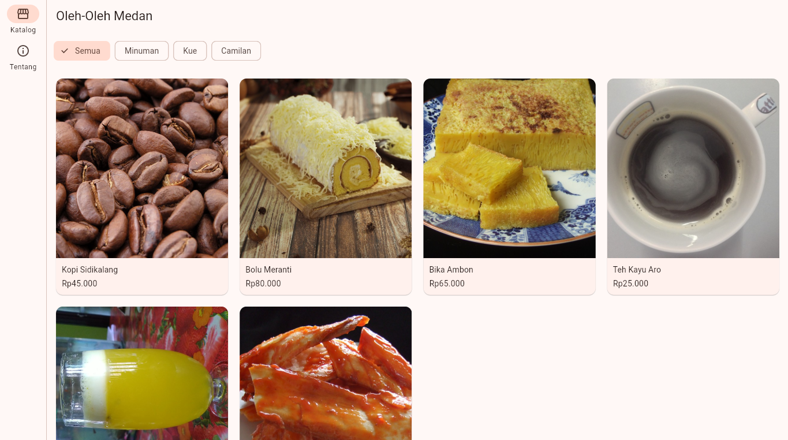
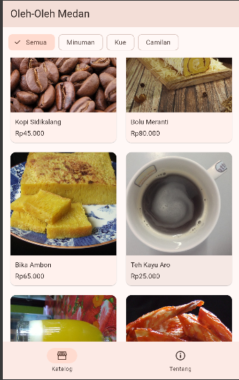
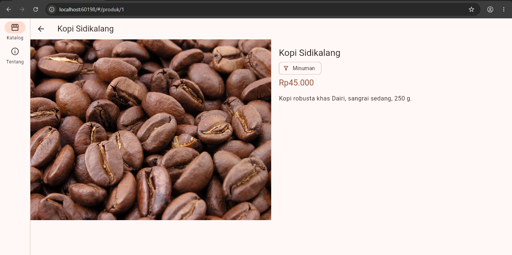
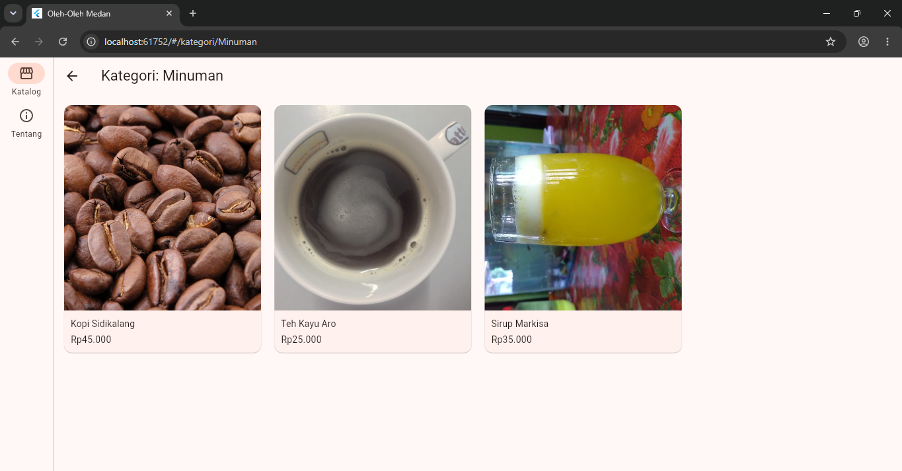
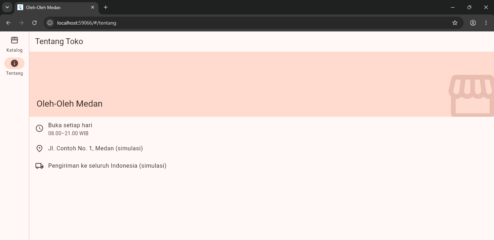
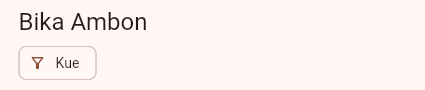
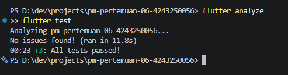

# Praktikum Pertemuan 6 — Katalog Oleh-Oleh Medan

**Layout Responsif dan Navigasi Multi-Screen dengan Flutter dan Material Design 3**

| Identitas | Keterangan |
|---|---|
| Nama | Micael Zecsen Saragih |
| NIM | 4243250056 |
| Kelas | PSIK24D |
| Program Studi | Ilmu Komputer |
| Universitas | Universitas Negeri Medan |
| Mata Kuliah | Pemrograman Mobile |
| Pertemuan | 6 |

## Deskripsi Proyek

**Katalog Oleh-Oleh Medan** adalah aplikasi Flutter multi-screen untuk menampilkan enam contoh produk khas Medan dan sekitarnya. Aplikasi menerapkan layout responsif agar tampilan menyesuaikan lebar layar, navigasi berbasis URL melalui `go_router`, halaman detail produk, filter kategori, serta halaman informasi toko.

Foto yang digunakan merupakan **gambar ilustratif/representatif** untuk kebutuhan praktikum, bukan klaim foto resmi produk atau merek. Informasi toko pada halaman Tentang merupakan data simulasi.

**Repository ini merupakan fondasi yang dilanjutkan pada Pertemuan 7** untuk mempraktikkan state management dan keranjang belanja.

## Fitur dan Kesesuaian Modul

| Materi / komponen | Implementasi |
|---|---|
| `Row`, `Column`, `Expanded` | Penyusunan layout dan pembagian ruang antarwidget |
| `Stack` dan `Positioned` | Header bertumpuk pada halaman Tentang |
| `LayoutBuilder` | Mengatur jumlah kolom katalog dan orientasi halaman detail |
| `MediaQuery.sizeOf(context)` | Memilih `NavigationBar` atau `NavigationRail` |
| `GridView.builder` | Menampilkan enam produk secara efisien |
| `go_router` dan `StatefulShellRoute.indexedStack` | Navigasi multi-screen dengan dua cabang Katalog/Tentang |
| `/produk/:id` | Detail produk dan parameter ID dari URL |
| Halaman ID tidak ditemukan | Penanganan ID produk tidak valid atau tidak tersedia |
| `FilterChip` | Filter kategori Semua, Minuman, Kue, Camilan |
| `/kategori/:nama` | Rute daftar produk berdasarkan kategori |
| `Hero` | Transisi visual antara kartu produk dan detail |
| `Image.asset` + `errorBuilder` | Gambar lokal dengan ikon sebagai fallback |

## Data Produk

| Produk | Kategori | Harga |
|---|---|---:|
| Kopi Sidikalang | Minuman | Rp45.000 |
| Bolu Meranti | Kue | Rp80.000 |
| Bika Ambon | Kue | Rp65.000 |
| Teh Kayu Aro | Minuman | Rp25.000 |
| Sirup Markisa | Minuman | Rp35.000 |
| Keripik Ubi Balado | Camilan | Rp20.000 |

Data contoh berasal dari model `Produk` di `lib/data.dart`. Harga dan informasi produk dipakai untuk demonstrasi, bukan daftar harga toko yang sedang beroperasi.

## Keputusan Layout Responsif

Aplikasi menggunakan dua pendekatan pengukuran yang berbeda. **`MediaQuery.sizeOf(context)`** membaca lebar jendela aplikasi untuk menentukan navigasi global: di bawah **840 dp** ditampilkan `NavigationBar` pada bagian bawah layar, sedangkan mulai **840 dp** digunakan `NavigationRail` di sebelah kiri.

Pada katalog, **`LayoutBuilder`** membaca ruang yang benar-benar tersedia bagi grid. Jumlah kolom ditentukan berdasarkan batas berikut:

| Lebar area katalog | Jumlah kolom |
|---|---:|
| Di bawah 600 dp | 2 |
| 600 sampai kurang dari 900 dp | 3 |
| 900 dp ke atas | 4 |

Halaman detail mempunyai breakpoint tersendiri: pada ruang kurang dari **700 dp**, gambar berada di atas informasi dalam `ListView`; pada ruang **700 dp atau lebih**, gambar dan informasi tampil berdampingan melalui `Row` dan `Expanded`. Penggunaan `TextOverflow.ellipsis` pada kartu membantu mencegah teks panjang merusak tata letak. Dengan demikian, keputusan untuk jumlah kolom dan susunan detail didasarkan pada constraint lokal, sedangkan posisi navigasi didasarkan pada ukuran jendela keseluruhan.

## Struktur Navigasi

```text
MaterialApp.router
└── StatefulShellRoute.indexedStack
    ├── Katalog (/)
    │   ├── Detail Produk (/produk/:id)
    │   └── Kategori (/kategori/:nama)
    └── Tentang (/tentang)
```

Rute `/produk/:id` membaca `state.pathParameters['id']`, lalu menggunakan `int.tryParse` dan `cariProduk` untuk menentukan produk. Jika tidak valid, aplikasi menampilkan halaman **Produk tidak ditemukan** dengan tombol kembali ke katalog. `context.go` dipakai untuk navigasi sesuai lokasi URL, sedangkan `StatefulShellRoute.indexedStack` mengelola cabang navigasi utama.

## Bukti Screenshot Hasil Praktikum

Semua gambar di bawah berasal dari hasil pelaksanaan aplikasi dan disimpan pada folder `docs/`.

### 1. Katalog Desktop

Tampilan katalog pada layar lebar, dengan `NavigationRail`, kategori, dan susunan grid responsif.



### 2. Katalog Mobile

Tampilan pada viewport sempit untuk membuktikan penggunaan `NavigationBar` dan grid dua kolom.



### 3. Detail Produk

Halaman detail produk melalui rute `/produk/:id`, menampilkan gambar, kategori, harga, dan deskripsi.



### 4. Filter Kategori

Implementasi `FilterChip` untuk menampilkan produk berdasarkan kategori yang dipilih.



### 5. Halaman Tentang

Halaman informasi toko menggunakan `Stack`, `Positioned`, serta navigasi antarlayar.



### 6. Rute Kategori

Dokumentasi navigasi kategori menggunakan parameter URL `/kategori/:nama`.



### 7. Flutter Analyze dan Widget Test

Bukti pemeriksaan kode serta hasil pengujian widget pada komputer mahasiswa.



## Struktur File Utama

```text
pm-pertemuan-06-4243250056/
├── lib/
│   ├── main.dart
│   ├── data.dart
│   ├── halaman_katalog.dart
│   ├── halaman_detail.dart
│   ├── halaman_kategori.dart
│   └── halaman_tentang.dart
├── assets/images/
│   ├── kopi_sidikalang.jpg
│   ├── bolu_meranti.jpg
│   ├── bika_ambon.jpg
│   ├── teh_kayu_aro.jpg
│   ├── sirup_markisa.jpg
│   └── keripik_balado.jpg
├── test/widget_test.dart
├── docs/
│   └── 01–07 screenshot dokumentasi
├── android/ · ios/ · web/ · linux/ · macos/ · windows/
├── pubspec.yaml
└── README.md
```

## Cara Menjalankan

Persyaratan: Flutter SDK dan perangkat yang dikenali oleh `flutter devices` (misalnya Chrome).

```powershell
git clone https://github.com/micaelsaragih/pm-pertemuan-06-4243250056.git
cd pm-pertemuan-06-4243250056
flutter pub get
flutter run -d chrome
```

Repository sudah menyertakan folder platform Flutter, sehingga tidak perlu menjalankan `flutter create` lagi pada hasil clone normal.

## Pengujian

```powershell
dart format .
flutter analyze
flutter test
flutter build web
```

**Hasil yang dilaporkan dari pengujian pada komputer mahasiswa dan agent lokal:**

| Pemeriksaan | Hasil |
|---|---|
| `dart format .` | Selesai |
| `flutter analyze` | `No issues found!` |
| `flutter test` | `All tests passed!` — 3/3 |
| `flutter build web` | Berhasil menurut laporan agent lokal |
| Uji lebar 360, 600, 840, 1280 dp | Dilaporkan tidak mengalami render overflow |

Tiga widget test yang tersedia menguji: (1) katalog dan FilterChip, (2) navigasi ke detail produk, dan (3) munculnya `NavigationRail` pada lebar layar yang sesuai. Tabel tersebut adalah hasil pengujian yang dilaporkan dari perangkat lokal, **bukan hasil eksekusi ulang dalam GitHub**.

## Sumber dan Atribusi Gambar

Gambar pada `assets/images/` dilaporkan diambil dari **Wikimedia Commons** dan diproses menjadi aset lokal rasio 4:3 untuk praktikum. Kredit dan lisensi berikut mengikuti metadata sumber yang dicatat saat pengunduhan oleh agent lokal. Penggunaan ulang di luar proyek ini perlu mengikuti ketentuan lisensi masing-masing sumber.

| Aset | Sumber dan kreator | Lisensi yang dilaporkan |
|---|---|---|
| `kopi_sidikalang.jpg` | [Roasted coffee beans](https://commons.wikimedia.org/wiki/File:Roasted_coffee_beans.jpg) — MarkSweep | Public Domain |
| `bolu_meranti.jpg` | [Bolu legenda malang keju topping keju](https://commons.wikimedia.org/wiki/File:Bolu_legenda_malang_keju_topping_keju.jpg) — Yodhadhika | CC BY-SA 4.0 |
| `bika_ambon.jpg` | [Kue bika ambon](https://commons.wikimedia.org/wiki/File:Kue_bika_ambon.JPG) — Sakurai Midori | CC BY 3.0 |
| `teh_kayu_aro.jpg` | [Black Tea](https://commons.wikimedia.org/wiki/File:Black_Tea.jpg) — Divas Grover | CC BY-SA 4.0 |
| `sirup_markisa.jpg` | [Passion Fruit juice](https://commons.wikimedia.org/wiki/File:Passion_Fruit_juice.jpg) — Dr. Chinchu C. | CC BY-SA 4.0 |
| `keripik_balado.jpg` | [Keripik singkong balado cassava chips](https://commons.wikimedia.org/wiki/File:Keripik_singkong_balado_cassava_chips.JPG) — Sakurai Midori | CC BY-SA 3.0 |

Foto dipotong/diubah ukurannya menjadi 800 × 600 piksel dan dikompresi untuk tampilan aplikasi. Atribusi ini tidak menyatakan bahwa gambar adalah foto resmi produk yang disebut dalam katalog.

Rujukan lisensi: [CC BY 3.0](https://creativecommons.org/licenses/by/3.0/) · [CC BY-SA 3.0](https://creativecommons.org/licenses/by-sa/3.0/) · [CC BY-SA 4.0](https://creativecommons.org/licenses/by-sa/4.0/).

## Refleksi Singkat

1. **Mengapa memakai `MediaQuery` dan `LayoutBuilder`?** `MediaQuery` membantu menentukan komponen navigasi berdasarkan jendela aplikasi, sementara `LayoutBuilder` menentukan susunan konten berdasarkan constraint dari parent.
2. **Bagaimana menangani ID produk yang tidak dikenal?** `int.tryParse` menghindari error parsing dan hasil `cariProduk` dapat bernilai `null` sehingga halaman fallback ditampilkan.
3. **Apa perbedaan `context.go` dan `context.push`?** `go` mengarahkan aplikasi ke lokasi rute, sedangkan `push` menumpuk halaman baru di atas navigasi saat ini.

## Riwayat Pengerjaan

Perubahan awal dipisahkan menjadi commit implementasi aplikasi, pengujian dan aset produk, serta dokumentasi screenshot. README ini diperbarui setelah seluruh file dokumentasi tersedia di repository.

## Pernyataan Penggunaan AI

AI digunakan sebagai alat bantu pembuatan source code, penyempurnaan tampilan produk, pengujian melalui agent lokal, dan penyusunan dokumentasi. Mahasiswa tetap bertanggung jawab memeriksa kode, menjalankan aplikasi, meninjau hasil pengujian, dan mengambil screenshot hasil kerja nyata.
